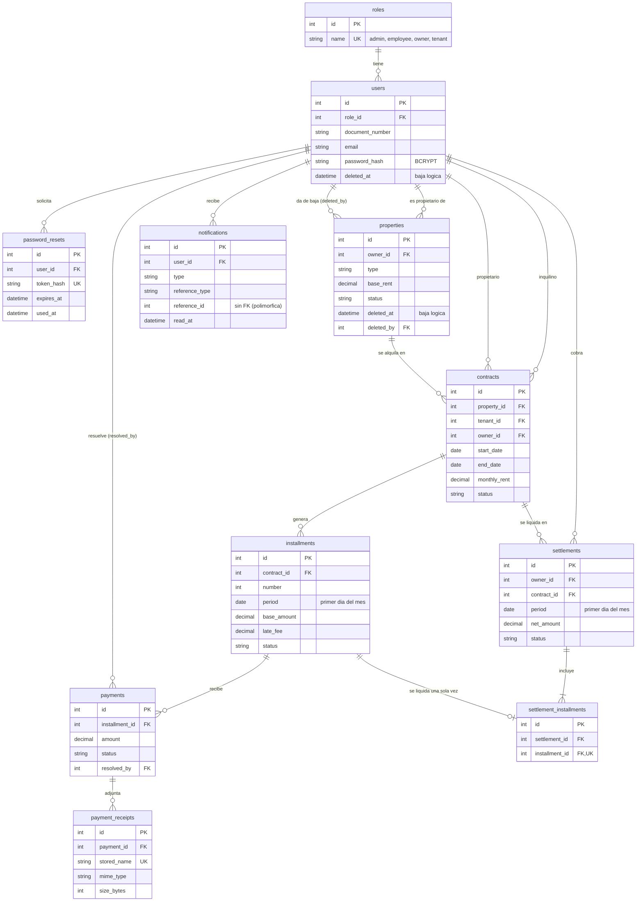

# Modelo de datos — InmoGestión 2026

> Última actualización: 06/11/2026. Cubre el issue #22 (base de datos): DER, modelo relacional, decisiones resueltas y cómo usar los archivos de esquema y de datos de prueba. **La fuente de verdad son las migraciones** de [`app/Database/Migrations/`](../../app/Database/Migrations/); este documento y los `.sql` se derivan de ellas. El alcance funcional y el glosario de estados salen del [análisis de requerimientos](../ANALISIS_DE_REQUERIMIENTOS.md) (secciones 4 y 9).

## Índice

1. [Archivos](#1-archivos)
2. [Diagrama entidad-relación](#2-diagrama-entidad-relación)
3. [Modelo relacional](#3-modelo-relacional)
4. [Reglas que hace cumplir la base de datos](#4-reglas-que-hace-cumplir-la-base-de-datos)
5. [Decisiones del issue #22](#5-decisiones-del-issue-22)
6. [Trazabilidad de historias de usuario a tablas](#6-trazabilidad-de-historias-de-usuario-a-tablas)
7. [Usar MySQL Workbench](#7-usar-mysql-workbench)
8. [Datos de prueba](#8-datos-de-prueba)
9. [Regenerar el esquema](#9-regenerar-el-esquema)
10. [Verificación y límites](#10-verificación-y-límites)

---

## 1. Archivos

| Archivo | Para qué sirve |
|---|---|
| [`app/Database/Migrations/`](../../app/Database/Migrations/) | Crean las 11 tablas, en orden de dependencias. Es lo que usa `php spark migrate` |
| [`app/Database/Seeds/DatabaseSeeder.php`](../../app/Database/Seeds/DatabaseSeeder.php) | Datos base: los cuatro roles y el administrador inicial (clave desde `.env`) |
| [`app/Database/Seeds/DemoSeeder.php`](../../app/Database/Seeds/DemoSeeder.php) y [`demo_data.sql`](../../app/Database/Seeds/demo_data.sql) | Datos de prueba. El seeder ejecuta el mismo SQL que se puede correr a mano en Workbench |
| [`inmogestion_schema.sql`](inmogestion_schema.sql) | Esquema completo en SQL, para Workbench (diagrama EER y comparación con la base real) |
| [`tests/database/SchemaIntegrityTest.php`](../../tests/database/SchemaIntegrityTest.php) | Pruebas de integridad: unicidad, claves foráneas y datos inválidos |
| [`.env.example`](../../.env.example) | Variables de entorno de la base y de los seeders, sin valores reales |

---

## 2. Diagrama entidad-relación



Todas las tablas tienen además `created_at` y `updated_at`. El diagrama muestra solo claves y campos principales; el detalle completo está en el [modelo relacional](#3-modelo-relacional) y en [`inmogestion_schema.sql`](inmogestion_schema.sql).

---

## 3. Modelo relacional

Notación: `PK` clave primaria, `FK→` clave foránea, `UK` único, `?` admite NULL. Los nombres siguen la convención de `AGENTS.md`: inglés y `snake_case`.

```
roles(id PK, name UK)

users(id PK, role_id FK→roles, first_name, last_name, document_number, email, phone?, address?,
      password_hash, deleted_at?,
      [generada] active_email UK, [generada] active_document_number UK)

password_resets(id PK, user_id FK→users, token_hash UK, expires_at, used_at?)

properties(id PK, owner_id FK→users, address, city, type, rooms?, surface?, included_services?,
           base_rent, description?, status, deleted_at?, deleted_by? FK→users)

contracts(id PK, property_id FK→properties, tenant_id FK→users, owner_id FK→users,
          start_date, end_date, monthly_rent, update_percentage, due_day,
          commission_percentage, late_fee_daily_percentage, status, closed_at?, closing_reason?,
          [generada] active_property_id UK)

installments(id PK, contract_id FK→contracts, number, period, due_date, base_amount, late_fee, status,
             UK(contract_id, period), UK(contract_id, number))

payments(id PK, installment_id FK→installments, amount, paid_on, method, reference_number, status,
         rejection_reason?, resolved_by? FK→users, resolved_at?)

payment_receipts(id PK, payment_id FK→payments, original_name, stored_name UK, mime_type, size_bytes)

settlements(id PK, owner_id FK→users, contract_id FK→contracts, period, gross_amount,
            commission_percentage, commission_amount, net_amount, status,
            transferred_at?, operation_number?, UK(contract_id, period))

settlement_installments(id PK, settlement_id FK→settlements, installment_id FK→installments UK)

notifications(id PK, user_id FK→users, type, message, reference_type?, reference_id?, read_at?)
```

Todas las tablas incluyen `created_at` y `updated_at` (nulos permitidos). Tipos: identificadores `INT UNSIGNED AUTO_INCREMENT`, importes `DECIMAL(12,2)`, porcentajes `DECIMAL(5,2)`, fechas `DATE`, fecha y hora `DATETIME`.

### Valores de los ENUM

Los valores se guardan en inglés; las etiquetas en español las pone la aplicación al mostrarlos.

| Columna | Valores |
|---|---|
| `properties.type` | `apartment` departamento, `house` casa, `commercial` local comercial, `land` terreno, `office` oficina |
| `properties.status` | `available` disponible, `rented` alquilado, `maintenance` en mantenimiento |
| `contracts.status` | `in_force` vigente, `finished` finalizado, `rescinded` rescindido |
| `installments.status` | `pending` pendiente, `overdue` vencida, `under_review` en revisión, `paid` pagada |
| `payments.method` | `bank_transfer` transferencia, `deposit` depósito, `digital_gateway` pasarela digital |
| `payments.status` | `pending_validation` pendiente de validación, `approved` aprobado, `rejected` rechazado |
| `payment_receipts.mime_type` | `application/pdf`, `image/jpeg`, `image/png` |
| `settlements.status` | `pending_transfer` pendiente de transferencia, `transferred` transferido |
| `notifications.type` | `payment_submitted`, `payment_approved`, `payment_rejected`, `installment_due_soon`, `contract_expiring` |
| `notifications.reference_type` | `payment`, `installment`, `contract` |

---

## 4. Reglas que hace cumplir la base de datos

[`SchemaIntegrityTest.php`](../../tests/database/SchemaIntegrityTest.php) prueba casi todas; el token de recuperación único y el límite inferior del comprobante (1 byte) solo se comprobaron a mano. Lo que no figura acá lo valida la aplicación.

| Regla | Cómo se garantiza |
|---|---|
| Email y DNI/CUIT únicos **solo entre usuarios activos** (HU-04) | Columnas generadas `active_email` y `active_document_number`, que valen el dato si `deleted_at` es NULL y NULL si no, con índice único. Quien fue dado de baja puede volver a registrarse |
| Un solo contrato vigente por inmueble (HU-10) | Columna generada `active_property_id` con índice único |
| Una cuota por contrato y período; numeración sin repetir por contrato (HU-13) | Únicos `(contract_id, period)` y `(contract_id, number)` |
| Una cuota se liquida una sola vez (HU-19) | Único en `settlement_installments.installment_id` |
| Una liquidación por contrato y período | Único `(contract_id, period)` |
| Sin borrado en cascada de datos contables ni de usuarios | Todas las claves foráneas son `ON DELETE RESTRICT` y `ON UPDATE RESTRICT` |
| Importes positivos, porcentajes entre 0 y 100, fin posterior al inicio, día de vencimiento de 1 a 28 | `CHECK` en `properties`, `contracts`, `installments`, `payments` y `settlements` |
| El período de cuotas y liquidaciones es el primer día del mes | `CHECK (DAY(period) = 1)` |
| Contrato vigente sin datos de cierre | `CHECK` sobre `closed_at` y `closing_reason` |
| Pago rechazado con motivo obligatorio (HU-17) | `CHECK` sobre `rejection_reason` |
| Pago pendiente sin responsable; pago resuelto con responsable y fecha | `CHECK` sobre `resolved_by` y `resolved_at` |
| Comprobante de 1 byte a 5 MB (HU-16) | `CHECK (size_bytes BETWEEN 1 AND 5242880)` |
| Neto de la liquidación igual a bruto menos comisión; datos de transferencia obligatorios al transferir y vacíos antes (HU-19, HU-20) | `CHECK` en `settlements` |
| Referencia de una notificación completa o vacía | `CHECK` sobre `reference_type` y `reference_id` |
| Nombre de archivo de comprobante único | Único en `payment_receipts.stored_name` |
| Token de recuperación único (HU-03b) | Único en `password_resets.token_hash` (solo se guarda el hash) |

**Lo que valida la aplicación** (la base no puede o no debe):

- Que `contracts.owner_id` coincida con el propietario del inmueble al crear el contrato.
- Que el inmueble y los usuarios de un contrato estén activos y que el inmueble esté disponible.
- Que la fecha de un pago o de una transferencia no sea futura, y que se marque la diferencia cuando el monto del pago no coincide con el exigible de la cuota (HU-16); el administrador la evalúa al verificar.
- Que la ciudad del inmueble sea obligatoria y los ambientes también, salvo en terrenos (HU-07).
- Que el motivo de cierre de un contrato, que la base admite vacío, se pida al cerrarlo (HU-12).
- Que una cuota solo se liquide si está pagada con un pago aprobado.
- Que la baja de un inmueble no ocurra con un contrato vigente.
- Que el tipo real del archivo de un comprobante sea el declarado (se verifica el contenido, no el nombre).

---

## 5. Decisiones del issue #22

Resueltas el 06/11/2026. Conviene anotarlas también en el issue.

| # | Decisión | Resolución | Motivo |
|---|---|---|---|
| 1 | Idioma de los nombres | **Inglés** | Lo exigen `AGENTS.md` y `code-conventions` para tablas y columnas |
| 2 | Unicidad con baja lógica | **Columnas generadas con índice único** | La propia base rechaza los duplicados, sin depender de que cada formulario valide |
| 3 | Estados | **`ENUM`** en la columna | Más simple que una tabla de catálogo por estado; agregar un valor requiere una migración |
| 4 | Granularidad de liquidaciones | **Una por contrato y período**, con las cuotas incluidas en `settlement_installments` | Es lo que propone el issue y calza con HU-21, donde cada fila muestra el inmueble. Un propietario con varios contratos tiene varias filas, con el mismo n.º de operación si se transfieren juntas |
| 5 | Día de vencimiento | **1 a 28** | Evita los meses cortos |
| 6 | Base de pruebas | **Grupo `tests` en MySQL/MariaDB** (`database.tests.*` en `.env`), no SQLite | `ENUM`, `CHECK` y columnas generadas son propios del motor |
| 7 | Cierre de contratos | Se guardan **`closed_at` y `closing_reason`** | Permite saber cuándo y por qué se cerró un contrato |
| 8 | Período de cuotas y liquidaciones | **`DATE` con el primer día del mes** | Se ordena, se indexa y se compara como fecha |
| 9 | Propietario en contratos y liquidaciones | **Se guarda** también en `contracts` y `settlements` | No se pierde el historial si el inmueble cambia de dueño |

Otras decisiones tomadas al diseñar:

- `settlements.period` es el mes de alquiler que se liquida, el mismo `period` de la cuota. Con la regla de una cuota por contrato y período, hoy cada liquidación incluye una cuota; la tabla intermedia deja abierta la posibilidad de agrupar más.
- `properties.rooms` admite NULL, porque un terreno no tiene ambientes. La aplicación lo exige para los demás tipos.
- `users.phone` y `users.address` admiten NULL; la aplicación decide si son obligatorios.
- Hay **cuatro roles**: `admin`, `employee`, `owner` y `tenant`. El enunciado habla de cuatro roles aunque solo describe tres, con "Administrador / Empleado" juntos; se separó el empleado del administrador. Como `roles` es una tabla, sumarlo no cambió el esquema. En qué se diferencian los permisos de uno y otro es una regla de la aplicación (filtros por rol) y todavía no está definida en los documentos de requisitos.
- `payment_receipts` admite varios comprobantes por pago; el issue no pide limitarlo.
- `notifications` guarda en `reference_type` y `reference_id` a qué registro se refiere, sin clave foránea porque apunta a tres tablas distintas.
- Las alertas de vencimiento (HU-23, HU-24) no tienen tabla propia: la aplicación las detecta con consultas, para las que hay índices `(status, due_date)` en cuotas y `(status, end_date)` en contratos. Para que tengan estado leída / no leída, cada alerta detectada se registra una sola vez en `notifications` con el tipo `installment_due_soon` o `contract_expiring`. La aplicación evita duplicarla; la base no lo garantiza con un índice único.
- La carpeta `writable/uploads/comprobantes/` viaja con el repositorio (vacía, con `.gitkeep`) y su contenido sigue ignorado por git.
- `php spark migrate:refresh` no tiene opción `--seed` en CodeIgniter 4.7: se hace `migrate:refresh` y después `db:seed`.

---

## 6. Trazabilidad de historias de usuario a tablas

| Historia | Tablas |
|---|---|
| HU-01, HU-02, HU-04, HU-05, HU-06 | `users`, `roles` |
| HU-03 | Ninguna (sesión del servidor) |
| HU-03b | `users`, `password_resets` |
| HU-07, HU-08, HU-09 | `properties`, `users` |
| HU-10, HU-11, HU-12 | `contracts`, `properties`, `users` |
| HU-13, HU-14 | `installments`, `contracts` |
| HU-15 | `installments`, `payments`, `payment_receipts` |
| HU-16, HU-17, HU-18 | `payments`, `payment_receipts`, `installments` |
| HU-19, HU-20, HU-21 | `settlements`, `settlement_installments` |
| HU-22 | `notifications` |
| HU-23, HU-24 | Consultas sobre `installments` y `contracts`; cada alerta se registra en `notifications` |
| HU-25, HU-26, HU-27 | Consultas sobre todas las tablas anteriores |

---

## 7. Usar MySQL Workbench

### Ver el diagrama (EER)

1. `File > New Model`.
2. `File > Import > Reverse Engineer MySQL Create Script...` y elegir [`inmogestion_schema.sql`](inmogestion_schema.sql).
3. Marcar `Place imported objects on a diagram` y ejecutar. Workbench solo lee el archivo, no toca ninguna base.

### Ver la base real mientras se prueba

- Crear una conexión a la base de `.env` (la misma de `database.default.*`).
- **Estructura:** `Database > Reverse Engineer...` sobre esa conexión dibuja el diagrama de lo que realmente hay. Repetirlo después de cada migración. `Database > Synchronize Model` compara el modelo importado contra la base real y muestra las diferencias.
- **Datos:** después de probar un flujo en la aplicación, ejecutar una consulta en una pestaña SQL (`Ctrl+Enter`) y volver a ejecutarla para ver los cambios. Algunas útiles:

```sql
-- Cuotas por estado, y su recargo por mora
SELECT status, COUNT(*) AS cuotas, SUM(late_fee) AS recargo_total FROM installments GROUP BY status;

-- Pagos esperando revisión del administrador
SELECT p.id, p.status, p.amount, p.paid_on, i.number, i.period FROM payments p JOIN installments i ON i.id = p.installment_id WHERE p.status = 'pending_validation';

-- Usuarios activos y dados de baja
SELECT id, email, deleted_at FROM users ORDER BY id;

-- Notificaciones sin leer por usuario
SELECT user_id, COUNT(*) AS sin_leer FROM notifications WHERE read_at IS NULL GROUP BY user_id;
```

### Crear la base desde el esquema

No se recomienda. Hay que usar `php spark migrate`: si las tablas se crean desde el `.sql`, la tabla `migrations` de CodeIgniter no lo sabe y la siguiente migración falla porque las tablas ya existen. El `.sql` usa `CREATE TABLE IF NOT EXISTS`, así que ejecutarlo sobre una base ya migrada no cambia nada.

---

## 8. Datos de prueba

[`demo_data.sql`](../../app/Database/Seeds/demo_data.sql) es el único archivo de datos: lo ejecuta el `DemoSeeder` de CodeIgniter y se puede correr a mano en Workbench, así que los dos caminos cargan exactamente lo mismo.

| Tabla | Filas | Qué hay |
|---|---|---|
| `users` | 9 | 1 administrador, 3 propietarios, 4 inquilinos y 1 usuario dado de baja. Todos con email `@example.com` |
| `properties` | 8 | De todos los tipos y estados, y 1 dado de baja con quién lo hizo |
| `contracts` | 6 | 4 vigentes (uno vence en 45 días), 1 finalizado y 1 rescindido |
| `installments` | 24 | 16 pagadas, 1 en revisión, 3 vencidas con recargo y 4 pendientes |
| `payments` | 19 | 16 aprobados, 1 pendiente de validación y 2 rechazados con motivo |
| `settlements` | 15 | 12 transferidas y 3 pendientes de transferencia |
| `notifications` | 7 | Leídas y sin leer, para administrador, propietario e inquilinos |

Las fechas son relativas al día de la carga, así que siempre hay cuotas vencidas y un contrato por vencer. No se cargan comprobantes (`payment_receipts`), porque necesitarían archivos reales en `writable/uploads/comprobantes/`.

**Cargarlos desde CodeIgniter:**

```bash
php spark db:seed DemoSeeder
```

La clave de todos los usuarios de demostración es `seed.demoPassword` de `.env`. No funciona en producción y, si ya están cargados, no hace nada.

**Cargarlos desde Workbench:** seleccionar el esquema (doble clic), abrir `demo_data.sql` y ejecutarlo. Los usuarios quedan con una clave inutilizable, para que nadie pueda iniciar sesión por accidente: para iniciar sesión con ellos hay que cargarlos con el seeder o definir una clave propia (las instrucciones están en el encabezado del archivo). Cargarlo dos veces falla por las claves únicas; para recargar desde cero, el encabezado trae las sentencias de limpieza, que **borran todos los datos** de la base.

**Reiniciar todo desde CodeIgniter:**

```bash
php spark migrate:refresh
php spark db:seed DatabaseSeeder
php spark db:seed DemoSeeder
```

---

## 9. Regenerar el esquema

[`inmogestion_schema.sql`](inmogestion_schema.sql) es una copia: **hay que regenerarla cada vez que cambie una migración**. Con la base ya migrada:

```bash
mysqldump -u USUARIO -p --no-data --compact --no-tablespaces --set-gtid-purged=OFF inmogestion2026 roles users password_resets properties contracts installments payments payment_receipts settlements settlement_installments notifications > esquema_crudo.sql
```

Después, reemplazar en el archivo generado `CREATE TABLE ` por `CREATE TABLE IF NOT EXISTS `, y pegar delante el encabezado del archivo actual (incluidas las sentencias `CREATE DATABASE IF NOT EXISTS` y `USE`). Las tablas van en ese orden para respetar las dependencias. Si el cliente avisa de un error de autenticación con `caching_sha2_password`, agregar `--get-server-public-key`.

---

## 10. Verificación y límites

Verificado el 06/11/2026 en instancias descartables de **MySQL 8.4.7** y **MariaDB 11.4.9**, y la creación en el **MySQL 8.0.45** real del equipo (`db:create`, `migrate` y `db:seed DatabaseSeeder`, con 16 claves foráneas, 24 `CHECK`, 3 columnas generadas, roles y administrador comprobados en solo lectura), donde además pasa `SchemaIntegrityTest` con PHPUnit 11.5.57 (34 pruebas, 56 aserciones; la suite completa del proyecto, 39 pruebas):

- `php spark migrate`, `migrate:rollback`, `migrate` de nuevo y `migrate:refresh` sobre una base vacía, sin errores.
- 64 comprobaciones de integridad (duplicados, claves foráneas, `CHECK`, casos límite), todas con el código de error esperado.
- `db:seed DatabaseSeeder` y `db:seed DemoSeeder` (dos veces cada uno, sin duplicar), y `demo_data.sql` ejecutado con el cliente SQL como lo haría Workbench, con el mismo resultado.
- `inmogestion_schema.sql` ejecutado desde cero, y otra vez sobre lo ya creado.

**No verificado:**

- **`composer test`.** La suite se corrió con PHPUnit 11.5.57 suelto (`phpunit-11.phar`, de phar.phpunit.de), no con Composer ni con el `vendor/` del proyecto, que no tiene `composer.lock`. Con las versiones que instale Composer (^10.5.16 o ^11.2) podrían aparecer diferencias.
- **Otras versiones de MySQL.** Los `CHECK` se hacen cumplir desde **MySQL 8.0.16**; en una versión anterior se ignoran sin avisar, así que cada integrante debería confirmar la suya con `SELECT VERSION();` antes de correr las pruebas.
- Versiones intermedias de MySQL y MariaDB entre las probadas.
